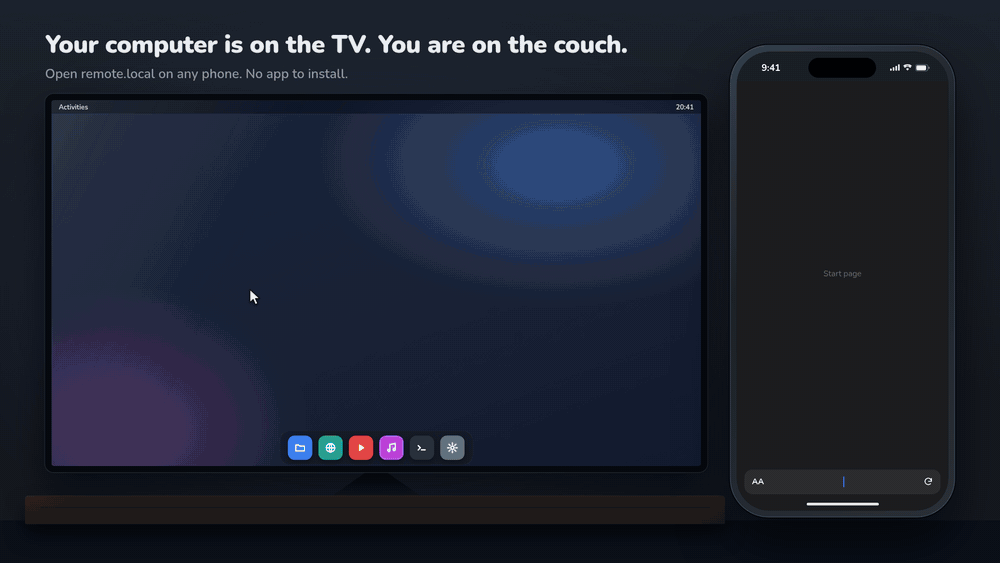
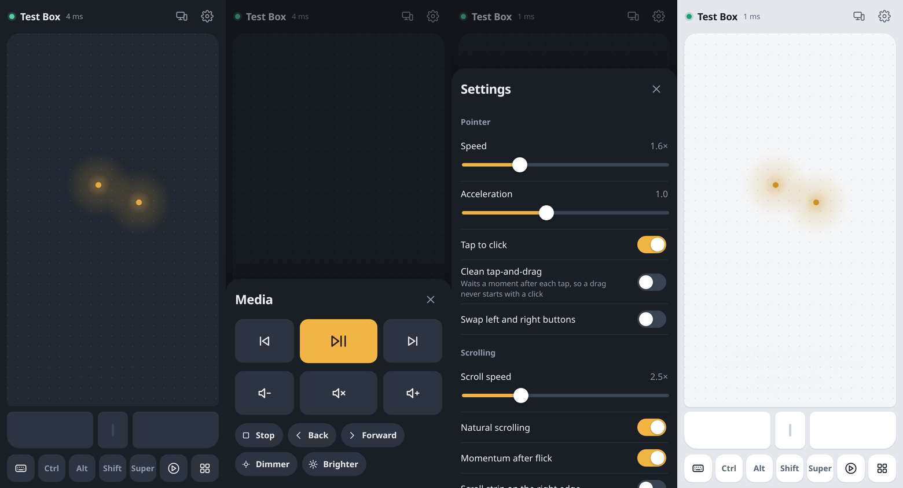

# OpenCouchpad

**Use any phone as a touchpad and keyboard for your computer. No app needed, just open `http://remote.local`.**

OpenCouchpad is a small self-hosted server for Linux (including Raspberry Pi) and Windows. It serves a fast web remote over your Wi-Fi, so it works the same on iPhone, Android, tablets and laptops.





## Why

Most remote-mouse apps are tied to one platform and need an app on every phone. OpenCouchpad runs in the browser instead. Install it once on the computer, and anyone at home can pick up their phone and use it.

- **Works in any browser.** iOS Safari, Android Chrome, Firefox, desktop browsers. You can add it to the home screen as an app.
- **Easy to find.** The computer announces itself as `remote.local` over mDNS. There's also a QR code in the terminal and in the app.
- **Fast and precise.** Binary WebSocket messages, no batching delay, sub-pixel accumulation, a tuned acceleration curve and hi-res smooth scrolling.
- **Several computers.** Run it on your Pi, desktop and Windows PC; each phone can switch between them from the app.
- **Self-hosted and private.** One ~8 MB static binary or a `scratch` Docker image. No cloud, no accounts, no telemetry. Optional PIN.

## Features

| | |
|---|---|
| **Touchpad** | Move, tap to click, two-finger tap for right-click, three-finger tap for middle-click, double-tap-and-hold to drag, two-finger scroll with momentum, optional pinch-to-zoom, optional edge scroll strip |
| **Mouse buttons** | Left, middle and right buttons you can hold, so you can drag with a second finger |
| **Keyboard** | Your phone's own keyboard, including autocorrect, swipe typing and accents. Plus a row of Esc/Tab/arrow/Home/End/PgUp/PgDn/Del keys with auto-repeat |
| **Modifiers** | Sticky Ctrl / Alt / Shift / Super. Tap once for the next action, twice to lock. They also work with clicks (Ctrl+click, Shift+click) |
| **Send text** | Paste a link or paragraph on the phone and have it typed on the computer |
| **Media** | Play/pause, previous/next, volume, mute, browser back/forward, screen brightness (Linux) |
| **Shortcuts** | Copy, paste, undo, redo, Alt+Tab app switcher, close window, full screen, zoom, show desktop, lock screen, function keys |
| **Comfort** | Pointer speed, acceleration and scroll speed sliders, natural scrolling, left-handed mode, haptics (Android), dark and light themes, portrait and landscape layouts |
| **Safety** | Nothing stays pressed: if a phone disconnects mid-drag, the server releases every button and key it was holding |

## Quick start

### Raspberry Pi / Linux: one command

```sh
curl -fsSL https://raw.githubusercontent.com/maros-o/opencouchpad/main/deploy/linux/install.sh | sudo sh
```

Then open **http://remote.local** on your phone (same Wi-Fi). That's it.

The script downloads the right binary for your machine (Pi 3/4/5 64-bit, 32-bit Pi OS, Pi Zero, PCs), installs it to `/usr/local/bin/opencouchpad` as a hardened systemd service that starts at boot, and loads the `uinput` module. Settings live in `/etc/default/opencouchpad` (name, PIN, port…); after editing run `sudo systemctl restart opencouchpad`. Logs: `journalctl -u opencouchpad -f`. Remove with `curl -fsSL …/install.sh | sudo sh -s -- --uninstall`.

Several computers on one network? Give each its own host name, e.g. `OPENCOUCHPAD_HOST=pi` → `http://pi.local`.

To update, run the same command again: it replaces the binary, keeps your settings and restarts the service.

### Raspberry Pi / Linux with Docker

```sh
docker run -d --name opencouchpad --restart unless-stopped \
  --network host --device /dev/uinput \
  -v /etc/default/keyboard:/etc/default/keyboard:ro \
  -e OPENCOUCHPAD_NAME="Living room" \
  ghcr.io/maros-o/opencouchpad:latest
```

Or use [`docker-compose.yml`](docker-compose.yml): `docker compose up -d`.

`--network host` is required so phones can reach the server and `remote.local` can be announced. `--device /dev/uinput` lets it create the virtual mouse and keyboard. If `/dev/uinput` is missing, run `sudo modprobe uinput` (and add `uinput` to `/etc/modules` so it loads at boot).

### Linux manual install

Download the binary for your machine from [Releases](https://github.com/maros-o/opencouchpad/releases) (`linux-arm64` for Pi 3/4/5 on 64-bit OS, `linux-armv7`/`armv6` for 32-bit Pi OS, `linux-amd64` for PCs) plus `opencouchpad-linux-deploy.tar.gz`, then:

```sh
mkdir opencouchpad-deploy && tar xzf opencouchpad-linux-deploy.tar.gz -C opencouchpad-deploy
sudo opencouchpad-deploy/install.sh ./opencouchpad-linux-arm64
```

To try it without installing:

```sh
chmod +x opencouchpad-linux-amd64
sudo ./opencouchpad-linux-amd64          # root for /dev/uinput and port 80
```

To run without root, use `deploy/linux/99-opencouchpad-uinput.rules` and join the `input` group. Then use `--port 8080`, or allow port 80 with `sudo setcap cap_net_bind_service=+ep ./opencouchpad`.

### Windows

1. Download `opencouchpad-windows-amd64.exe` (or `arm64`) from [Releases](https://github.com/maros-o/opencouchpad/releases).
2. Double-click it. Allow it through the firewall on **private networks** when Windows asks.
3. Open `http://remote.local` on your phone. If another computer is already called `remote`, use the name shown in the console.

To start it automatically at login, open a terminal next to the exe and run:

```powershell
.\opencouchpad-windows-amd64.exe --install --name "Office PC" --host office
```

Or run `install-windows.ps1` from the release; it also adds the firewall rule. Remove autostart with `--uninstall`. In background mode, logs go to `%LOCALAPPDATA%\OpenCouchpad\opencouchpad.log`.

> Windows runs OpenCouchpad as a normal program in your session, not as a service. Services can't move the cursor on your desktop, and Docker on Windows can't control the host.

## Using it

Open the address shown at startup on a phone on the same Wi-Fi:

```
╭─ OpenCouchpad ─────────────────────────────────────
│  Open on your phone (same Wi-Fi):
│    http://remote.local
│    http://192.168.1.23
╰──────────────────────────────────────────────────
  Scan to open http://192.168.1.23:  [QR code]
```

| Gesture | Action |
|---|---|
| One finger | Move the pointer |
| Tap | Left click |
| Two-finger tap | Right click |
| Three-finger tap | Middle click |
| Double-tap, keep finger down and move | Drag (selecting text, moving windows) |
| Two fingers | Scroll vertically and horizontally; flick for momentum |
| Pinch (enable in Settings) | Zoom (Ctrl + wheel) |
| Hold a button below the pad | Press and hold that mouse button |

**Tip:** on iPhone, tap *Share > Add to Home Screen* for a full-screen app. On Android, use *Add to Home screen* or *Install app*.

### Several computers

Give each computer its own name and host:

```sh
opencouchpad --name "Raspberry Pi" --host pi        # http://pi.local
opencouchpad --name "Gaming PC"   --host gaming    # http://gaming.local
```

OpenCouchpad computers find each other on the network. Tap the computer name at the top of the app to switch. If two use the same host name, the second one automatically becomes `remote-2`.

### Network and firewall

The phone and the computer must be on the same network, and the phone must be able to reach the computer:

| Port | Protocol | What for |
|---|---|---|
| `80` | TCP | The web app and its WebSocket connection (or the port you set with `--port`; `8080` if 80 was busy) |
| `5353` | UDP (multicast `224.0.0.251`) | mDNS: announcing `remote.local` and finding other OpenCouchpad computers |

Only port 80 is strictly needed. Without mDNS, open the computer's IP address or scan the QR code instead of `remote.local`.

- **Linux:** the install script opens both ports if `ufw` or `firewalld` is active. For a manual setup: `sudo ufw allow 80/tcp && sudo ufw allow 5353/udp`, or `sudo firewall-cmd --permanent --add-service=http --add-service=mdns && sudo firewall-cmd --reload`.
- **Windows:** allow OpenCouchpad on **private networks** when Windows asks (`install-windows.ps1` adds the rule for you). Your Wi-Fi must be set to *Private* in *Settings > Network & internet*. On a *Public* network Windows blocks incoming connections.
- **Router:** guest networks and "AP/client isolation" stop devices from talking to each other. Use the main network.
- **Testing from the computer itself:** phones resolve `.local` names out of the box, but some Linux desktops don't. If `remote.local` fails in a browser on the computer itself (e.g. on Arch), use `http://localhost`, or install `nss-mdns` and add `mdns_minimal [NOTFOUND=return]` before `resolve` on the `hosts:` line in `/etc/nsswitch.conf`.

## Configuration

Every flag can also be set as an environment variable (used by Docker and the systemd config file).

| Flag | Env | Default | Description |
|---|---|---|---|
| `--name` | `OPENCOUCHPAD_NAME` | hostname | Name shown in the app and to other computers |
| `--host` | `OPENCOUCHPAD_HOST` | `remote` | mDNS name, giving `http://<host>.local` |
| `--port` | `OPENCOUCHPAD_PORT` | `80` | HTTP port. If 80 is busy and no port was set, falls back to 8080 |
| `--listen` | `OPENCOUCHPAD_LISTEN` | all | Address to bind to |
| `--pin` | `OPENCOUCHPAD_PIN` | none | PIN required before a phone can control the computer |
| `--allowed-hosts` | `OPENCOUCHPAD_ALLOWED_HOSTS` | none | Extra host names to accept, e.g. `remote.example.com` behind a reverse proxy. IPs, single-word names, `.local`, `.lan` and `.home.arpa` always work |
| `--layout` | `OPENCOUCHPAD_LAYOUT` | `auto` | Keyboard layout of this computer (Linux typing). See below |
| `--mdns` | `OPENCOUCHPAD_MDNS` | `true` | Announce `<host>.local` and discover other computers |
| `--driver` | `OPENCOUCHPAD_DRIVER` | `native` | `native` or `dryrun` (logs input instead of sending it; for development) |
| `--log-level` | `OPENCOUCHPAD_LOG_LEVEL` | `info` | `debug`, `info`, `warn` or `error` |
| `--install` / `--uninstall` | | | Windows: start at login, or stop starting at login |
| `--background` | | | Windows: no console window; log to a file |

### Keyboard layouts (Linux)

On Linux, OpenCouchpad types by pressing virtual keys, so it needs to know the keyboard layout the desktop uses. Otherwise a Czech or German layout would turn `z` into `y`. It reads the layout from `/etc/default/keyboard` (Debian, Raspberry Pi OS, Ubuntu) or `/etc/X11/xorg.conf.d/00-keyboard.conf` (`localectl`), and you can override it with `--layout` or per phone in *Settings > Computer keyboard layout*.

There are 34 built-in layouts, generated from xkeyboard-config, including AltGr symbols and dead-key accents: us, us(intl), gb, de, at, ch, fr, be, es, latam, pt, br, it, nl, se, no, dk, fi, is, pl, cz, cz(qwerty), sk, sk(qwerty), hu, si, hr, ro, tr, lt, lv, ee, and more. Windows doesn't need any of this: it types Unicode directly, so every character works with every layout.

## Security

OpenCouchpad gives full mouse and keyboard control to anyone who can open the page.

- **On a home network you trust**, the default (no PIN) is convenient.
- **On shared, office or guest networks, set a PIN** (`--pin`). After the correct PIN, the phone stays signed in. Repeated wrong PINs lock that address out for a while.
- Requests for unknown host names are rejected, which blocks DNS-rebinding attacks from websites.
- Traffic is plain HTTP on your LAN, like most local devices. Don't expose the port to the internet. For remote access, use a VPN such as WireGuard or Tailscale.
- On Linux the systemd service runs with a restrictive sandbox, and the virtual keyboard can't send power or Wi-Fi-kill keys.

## Troubleshooting

**`remote.local` doesn't open.** First check [Network and firewall](#network-and-firewall): try `http://<computer IP>` from the phone; if that fails too, a firewall or the router is blocking it. Most Android versions before 12 and some Wi-Fi routers don't resolve `.local` names. Use the IP address or scan the QR code from the terminal (also in *Settings > Connect another phone*), then add it to your home screen. Check that the phone isn't on a guest network that isolates clients.

**The pointer feels too fast or "floaty".** Your desktop also applies its own acceleration to OpenCouchpad's virtual mouse. For the most precise feel, set the pointer acceleration profile to *flat* for "OpenCouchpad Mouse": KDE *Settings > Mouse*, GNOME Tweaks *Mouse acceleration*, Windows *Mouse > Enhance pointer precision* off. Then tune speed in the app.

**Typed characters are wrong (Linux).** Set the layout: `--layout de`, or change it in the app's Settings. Characters that your layout can't type are reported in the app.

**`open /dev/uinput: permission denied`.** Run as root, use Docker with `--device /dev/uinput`, or install the udev rule and join the `input` group. **`no such file`**: `sudo modprobe uinput`.

**Windows: clicks don't work in some windows.** Windows blocks input from normal programs into apps running as administrator (UIPI). Run OpenCouchpad as administrator if you need to control those. The lock screen and UAC prompts can't be controlled.

**Port 80 is already in use.** OpenCouchpad falls back to 8080 and prints the address. You can also choose a port with `--port`.

**Scrolling goes the wrong way.** Turn off *Natural scrolling* in Settings.

## How it works

```
phone browser ──HTTP──▶ opencouchpad (single Go binary, no cgo)
               ◀──WS──▶   ├─ embedded web app (vanilla JS, ~75 KB, gzipped, no build step)
                          ├─ input: Linux /dev/uinput · Windows SendInput
                          ├─ keymap: XKB layout tables for Linux typing
                          └─ mDNS responder: <host>.local + _opencouchpad._tcp discovery
```

- **Low latency end to end:** pointer deltas are sent as 5-byte binary WebSocket frames straight from the touch handler, not delayed to the next animation frame. The client only merges deltas when the socket's send buffer backs up, so weak Wi-Fi never causes a "replay" of stale movement. TCP_NODELAY is on. On Linux each event batch is one `write()` to uinput.
- **Precision:** fractional motion is carried over between events, so nothing is lost to rounding. A 3 px dead zone at touch start (replayed once you move) keeps taps from nudging the pointer. Acceleration is based on smoothed finger speed.
- **Smooth scrolling:** hi-res wheel events (`REL_WHEEL_HI_RES` on Linux, sub-notch `WHEEL_DELTA` on Windows) in 1/120-notch steps, plus momentum after a flick.
- **Works on Wayland and X11:** uinput devices are real input devices to the kernel, so it works on any desktop, compositor or console, including Raspberry Pi OS (Wayfire/labwc).
- **Protocol:** binary `0x01 move i16 dx i16 dy` and `0x02 scroll i16 dx i16 dy`; JSON for buttons, keys, text and ping. See [AGENTS.md](AGENTS.md) for details.

## Development

Requirements: Go 1.26+, Node (only for `node --check` in tests).

```sh
make dev       # run with the dry-run driver on :8080 (logs input; your mouse stays yours)
make test      # go vet, race tests, JS syntax check
make run       # real input (needs /dev/uinput access)
make dist      # cross-compile all release binaries into dist/
make docker    # multi-arch image with buildx
make layouts   # regenerate keyboard layouts (needs xkbcli + xkeyboard-config)
```

The web app lives in [`web/`](web) and is embedded into the binary. Rebuild the binary to see changes. Layout: `cmd/opencouchpad` (CLI), `internal/input` (uinput/SendInput), `internal/keymap`, `internal/server` (HTTP + WebSocket), `internal/mdns`.

Contributions are welcome. See [CONTRIBUTING.md](CONTRIBUTING.md).

## Roadmap

- macOS server (CGEvent)
- Optional HTTPS for screen wake lock and clipboard sync
- Air mouse (gyroscope) mode
- Custom shortcut buttons

## License

[MIT](LICENSE)
