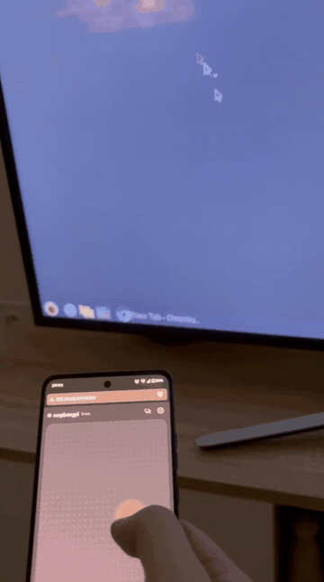
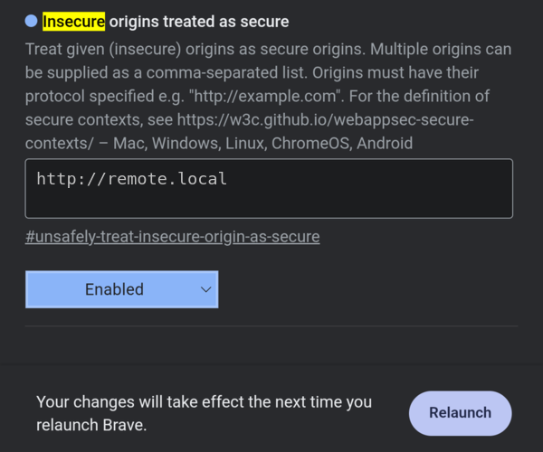

# OpenCouchpad

[](https://github.com/maros-o/opencouchpad/actions/workflows/ci.yml)
[](https://github.com/maros-o/opencouchpad/releases/latest)
[](https://github.com/maros-o/opencouchpad/pkgs/container/opencouchpad)
[](LICENSE)

**Use any phone as a touchpad and keyboard for your computer. No app needed, just open `http://remote.local`.**

<p align="center"></p>

A tiny self-hosted server for Linux (including Raspberry Pi), Windows and macOS. It serves a fast web remote over your Wi-Fi, so it works on iPhone, Android, tablets and laptops alike.


## Why

- **No app on the phone.** Any browser works, and you can add it to the home screen.
- **Easy to find.** The computer announces itself as `remote.local`, and shows a QR code.
- **Fast and precise.** Binary WebSocket messages, sub-pixel accuracy, tuned acceleration, hi-res smooth scrolling.
- **Several computers.** Switch between your Pi, PC and Mac from the app.
- **Lightweight.** One ~8 MB static binary, under 18 MB of RAM, a ~75 KB web app with no frameworks. Fine on a Pi Zero.
- **Private.** No cloud, no accounts, no telemetry. Optional PIN.

Compared to others: **KDE Connect** does much more, but needs an app on every phone. **Unified Remote** and **Remote Mouse** need an app, are closed source and partly paid. **Linux Remote** and similar apps are Android only, and full of ads.

## Features

- **Touchpad:** tap to click, two/three-finger tap for right/middle click, drag, two-finger scroll with momentum, optional pinch-to-zoom
- **Keyboard:** your phone's own keyboard, including autocorrect, swipe typing and accents, plus Esc/Tab/arrow keys and *Send text* for pasting
- **Modifiers:** sticky Ctrl / Alt / Shift / Super, also for clicks
- **Media and shortcuts:** play/pause, volume, brightness, copy/paste, Alt+Tab, full screen, lock screen, function keys
- **Comfort:** speed and acceleration sliders, natural scrolling, left-handed mode, dark and light themes
- **Safe:** if a phone disconnects mid-drag, nothing stays pressed


## Install

### Raspberry Pi / Linux

```sh
curl -fsSL https://raw.githubusercontent.com/maros-o/opencouchpad/main/deploy/linux/install.sh | sudo sh
```

Then open **http://remote.local** on your phone (same Wi-Fi). Run the same command to update; add `-s -- --uninstall` after `sudo sh` to remove it.

It installs a sandboxed systemd service, saves your keyboard layout and opens the firewall (`ufw`/`firewalld`). Settings are in `/etc/default/opencouchpad`; apply them with `sudo systemctl restart opencouchpad`. Logs: `journalctl -u opencouchpad -f`.

<details>
<summary>Docker</summary>

```sh
docker run -d --name opencouchpad --restart unless-stopped \
  --network host --device /dev/uinput \
  -v /etc/default/keyboard:/etc/default/keyboard:ro \
  -e OPENCOUCHPAD_NAME="Living room" \
  ghcr.io/maros-o/opencouchpad:latest
```

Or `docker compose up -d` with [`docker-compose.yml`](docker-compose.yml). `--network host` is needed for `remote.local`. If `/dev/uinput` is missing, run `sudo modprobe uinput` (and add `uinput` to `/etc/modules`).

</details>

<details>
<summary>Manual install</summary>

Download your binary from [Releases](https://github.com/maros-o/opencouchpad/releases) (`linux-arm64` for 64-bit Pi OS, `linux-armv7`/`armv6` for 32-bit, `linux-amd64` for PCs) and `opencouchpad-linux-deploy.tar.gz`:

```sh
mkdir opencouchpad-deploy && tar xzf opencouchpad-linux-deploy.tar.gz -C opencouchpad-deploy
sudo opencouchpad-deploy/install.sh ./opencouchpad-linux-arm64
```

To just try it: `sudo ./opencouchpad-linux-amd64`. To run without root, install `deploy/linux/99-opencouchpad-uinput.rules`, join the `input` group and use `--port 8080`.

</details>

### Windows

1. Download `opencouchpad-windows-amd64.exe` (or `arm64`) from [Releases](https://github.com/maros-o/opencouchpad/releases) and double-click it. It isn't code-signed, so in SmartScreen click **More info > Run anyway**.
2. Allow it through the firewall on **private networks**. Your Wi-Fi must be set to *Private*, not *Public*.
3. Open `http://remote.local` on your phone.

To start it at login, run `.\opencouchpad-windows-amd64.exe --install --name "Office PC"` (or `install-windows.ps1` from the release, which also adds the firewall rule). Undo with `--uninstall`. Logs: `%LOCALAPPDATA%\OpenCouchpad\opencouchpad.log`.

### macOS

```sh
curl -fsSL https://raw.githubusercontent.com/maros-o/opencouchpad/main/deploy/macos/install.sh | sh
```

It installs a login item, no sudo needed. Then allow **Accessibility** access for `opencouchpad` in *System Settings > Privacy & Security* and restart it with `launchctl kickstart -k gui/$(id -u)/io.github.maros-o.opencouchpad`. Uninstall with `... | sh -s -- --uninstall`. Logs: `~/Library/Logs/OpenCouchpad/opencouchpad.log`.

## Usage

| Gesture | Action |
|---|---|
| One finger | Move |
| Tap / two-finger tap / three-finger tap | Left / right / middle click |
| Double-tap and hold, then move | Drag |
| Two fingers | Scroll (flick for momentum) |
| Pinch (enable in Settings) | Zoom |

Tap the keyboard button to type with your phone's keyboard. On iPhone, *Share > Add to Home Screen* gives a full-screen app; for Android see [Troubleshooting](#troubleshooting).

**Several computers:** give each its own name and host, e.g. `--name "Gaming PC" --host gaming` → `http://gaming.local`. They find each other; tap the computer name at the top of the app to switch.

## Configuration

Every flag also works as an environment variable (Docker, `/etc/default/opencouchpad`).

| Flag | Env | Default | |
|---|---|---|---|
| `--name` | `OPENCOUCHPAD_NAME` | hostname | Name shown in the app |
| `--host` | `OPENCOUCHPAD_HOST` | `remote` | Gives `http://<host>.local` |
| `--port` | `OPENCOUCHPAD_PORT` | `80` | Falls back to 8080 if 80 is busy |
| `--listen` | `OPENCOUCHPAD_LISTEN` | all | Address to bind to |
| `--pin` | `OPENCOUCHPAD_PIN` | none | PIN required to connect |
| `--allowed-hosts` | `OPENCOUCHPAD_ALLOWED_HOSTS` | none | Extra host names, e.g. behind a reverse proxy |
| `--layout` | `OPENCOUCHPAD_LAYOUT` | `auto` | Keyboard layout (Linux) |
| `--mdns` | `OPENCOUCHPAD_MDNS` | `true` | Announce `<host>.local` and find other computers |
| `--driver` | `OPENCOUCHPAD_DRIVER` | `native` | `dryrun` logs input instead (development) |
| `--log-level` | `OPENCOUCHPAD_LOG_LEVEL` | `info` | `debug`, `info`, `warn`, `error` |
| `--install` / `--uninstall` | | | Windows, macOS: start at login |
| `--background` | | | Windows, macOS: no console, log to a file |
| `--detect-layout` | | | Print the detected keyboard layout and exit |

**Keyboard layout (Linux only):** OpenCouchpad types by pressing keys, so it must know the desktop's layout, or `z` turns into `y` on a German one. `auto` reads KDE's settings, `/etc/default/keyboard` or the `localectl` config. 34 layouts are built in (us, gb, de, fr, es, it, pl, cz, sk, hu, nordic, baltic and more). Override with `--layout` or in the app's settings. Windows and macOS type Unicode directly and need nothing.

## Security

Anyone who can open the page controls your mouse and keyboard.

- On a trusted home network, no PIN is fine. **On shared networks, set `--pin`.** Wrong PINs are rate-limited.
- Unknown host names are rejected, which blocks DNS rebinding.
- It's plain HTTP on your LAN. Don't expose it to the internet; use WireGuard or Tailscale for remote access.
- On Linux it runs in a systemd sandbox and can't send power keys.

## Troubleshooting

**`remote.local` doesn't open.** Use the IP address shown at startup and in *Settings > Connect another phone*. Android before 12 can't open `.local` names. If the IP fails too, check:
- the firewall: TCP port `80` must be open (and UDP `5353` for mDNS). On Linux: `sudo ufw allow 80/tcp && sudo ufw allow 5353/udp`
- on Windows, the network must be *Private*
- guest Wi-Fi and "AP isolation" on the router block devices from talking to each other

**No *Install app* in Chrome on Android.** Chrome installs apps only from HTTPS sites. Open `chrome://flags/#unsafely-treat-insecure-origin-as-secure`, enter `http://remote.local` (plus the IP if you use it, comma-separated), enable it and relaunch. Then *⋮ > Add to Home screen > Install*. Works the same in Brave and Edge.



**The pointer feels floaty.** Set your desktop's pointer acceleration to *flat* for "OpenCouchpad Mouse" (or turn off *Enhance pointer precision* on Windows), then tune speed in the app.

**Wrong characters when typing (Linux).** Set the layout, e.g. `OPENCOUCHPAD_LAYOUT=de`, or pick it in the app's settings.

**`/dev/uinput`: permission denied or no such file.** Run as root (or use the udev rule), and `sudo modprobe uinput`.

**Windows: clicks don't work in some windows.** Apps running as administrator ignore input from normal programs. Run OpenCouchpad as administrator to control them.

**Testing on the Linux computer itself.** Some distros don't resolve `.local` in the browser; use `http://localhost`, or install `nss-mdns`.

## Status

Tested with real phones on Linux (KDE Plasma, Wayland) and Windows; gestures have automated browser tests. Raspberry Pi has had less real-world testing, and **macOS is new and untested on real hardware**. Reports are very welcome: [open an issue](https://github.com/maros-o/opencouchpad/issues).

## How it works

```
phone browser ──HTTP──▶ opencouchpad (single Go binary, no cgo)
               ◀──WS──▶   ├─ embedded web app (vanilla JS, no build step)
                          ├─ input: Linux /dev/uinput · Windows SendInput · macOS CGEvent
                          ├─ keymap: XKB layout tables for Linux typing
                          └─ mDNS: <host>.local + discovery of other computers
```

Pointer moves go out as 5-byte WebSocket frames straight from the touch handler and are only merged when Wi-Fi backs up, so movement never lags behind. uinput devices are real kernel input devices, so it works on Wayland, X11 and the console. Protocol details are in [AGENTS.md](AGENTS.md).

## Development

Requires Go 1.26+ and Node (for `node --check` in tests).

```sh
make dev       # dry-run driver on :8080, logs input instead of moving your mouse
make test      # go vet, race tests, JS syntax check
make run       # real input (needs /dev/uinput access)
make dist      # cross-compile release binaries into dist/
make docker    # multi-arch image with buildx
make layouts   # regenerate keyboard layouts (needs xkbcli + xkeyboard-config)
```

The web app in [`web/`](web) is embedded into the binary, so rebuild to see changes. See [CONTRIBUTING.md](CONTRIBUTING.md).

## Roadmap

- Optional HTTPS for screen wake lock and clipboard sync
- Air mouse (gyroscope) mode
- Custom shortcut buttons

## License

[MIT](LICENSE)
